# sempa-look

Semantic Packet Aggregation for Token Communication

Reproducing, analyzing, and extending SemPA-Look for semantic communication

Overview

SEMPA-LOOK is a research implementation and experimental framework for studying **semantic packet aggregation (SemPA)** in token communication.

The project reproduces and analyzes the 2026 IEEE Transactions on Communications paper:

> Low-Complexity Semantic Packet Aggregation for Token Communication via Lookahead Search
> S. Lee, J. Park, J. Choi, and H. Park, IEEE Transactions on Communications, 2026.

The central problem is simple to state:

> How should the tokens of a message be grouped into packets so that the message retains as much semantic meaning as possible when packets are lost?**

Unlike conventional bit communication, tokens are not independent. The semantic meaning of a token depends on its surrounding context. Consequently, packetizing tokens becomes a **combinatorial optimization problem**.

SEMPA-LAB aims to go beyond simply reproducing the paper:

                    SEMPA-LAB
                        │
          ┌─────────────┼─────────────┐
          │             │             │
      REPRODUCE      ANALYZE        EXTEND
       the paper     its limits     the method
          │             │             │
          └─────────────┼─────────────┘
                        │
                 Research System

The research workflow is deliberately ordered:


WHAT THE PAPER CLAIMS
          ↓
WHAT THE CODE IMPLEMENTS
          ↓
WHAT THE EXPERIMENTS SHOW
          ↓
WHAT CAN BE IMPROVED


Extensions are only introduced after the baseline has been verified.

> **Reproduction status:** the paper's MS-COCO and WikiHow results are reproduced with its encoder and channel, most within 1 % of the published numbers. See [Stage 4](#stage-4--paper-reproduction) and the [reproduction report](docs/reproduction.md).
>
> **First extension:** [channel-aware aggregation](docs/channel_aware.md) under bursty (Gilbert–Elliott) and fading erasures. See [Research extension 1](#research-extension-1--channel-aware-aggregation).

---

# Research Question

> **Can we reproduce SemPA-Look locally, explain why it works, identify where it breaks, and build a more adaptive version that improves the quality–robustness–computation trade-off?**

The project therefore focuses on three dimensions:

* **Semantic quality**
* **Robustness to packet loss**
* **Computational complexity**

The goal is not merely to maximize semantic similarity.

The goal is to understand the **quality–complexity trade-off**.

---

# Why Semantic Packet Aggregation?

Consider a message consisting of `K` tokens:

```text
W = {w₁, w₂, ..., wₖ}
```

These tokens are divided into `N` subpackets, each containing `M` tokens:

```text
N = K / M
```

For example:

```text
Message:

[a] [man] [riding] [a] [bicycle] [near] [the] [beach]

                 ↓ packetization

C₁ = {a, riding, bicycle, beach}
C₂ = {man, a, near, the}
```

If a packet is lost, all of its tokens disappear from the reconstructed message.

The important observation is that **which tokens are grouped together matters**.

A good packetization should make the remaining tokens preserve as much of the original semantic meaning as possible.

---

# The Combinatorial Problem

The number of valid ways to partition `K` tokens into `N = K/M` unordered subpackets of size `M` is

$$
\frac{K!}{(M!)^N N!}.
$$

This grows extremely quickly.

For example:

| `K` | `M` | Number of partitions |
| --: | --: | -------------------: |
|   8 |   4 |                   35 |
|   9 |   3 |                  280 |
|  12 |   4 |                5,775 |
|  12 |   3 |               15,400 |
|  16 |   4 |            2,627,625 |

And evaluating a single partition requires considering the possible packet-loss states.

With `N` subpackets, there are:

$$
2^N
$$

possible received/lost-subpacket combinations.

Therefore:

```text
More tokens
    ↓
More possible partitions
    ↓
More semantic encoder evaluations
    ↓
Rapidly increasing computational cost
```

This is the central problem SemPA-Look attempts to address.

---

# Core Idea: SemPA-Look

The paper introduces two key ideas:

1. **Residual Semantic Score (RSS)** as a token-level surrogate for the message-level ATS objective.
2. **Lookahead search** to avoid the exponential cost of exhaustive partition search.

Instead of evaluating every possible complete partition, SemPA-Look makes the packetization decision sequentially.

At each depth:

```text
Remaining tokens
       │
       ▼
Sample P candidate groups
       │
       ├──────────────┐
       ▼              ▼
 Candidate 1      Candidate 2      ...
       │              │
       ▼              ▼
 Lookahead         Lookahead
 evaluations       evaluations
       │              │
       └───────┬──────┘
               ▼
        Score candidates
               │
               ▼
        Commit best group
               │
               ▼
       Remove its tokens
               │
               ▼
             Repeat
```

For each candidate `C`, the algorithm evaluates its residual semantic score together with `k` lookahead candidates:

$$
\Psi(C)
=
\frac{1}{k+1}
\left[
\psi(C,W)
+
\sum_{i=1}^{k}\psi(\hat C_i,W)
\right].
$$

The candidate with the highest score is committed.

The process continues until the complete partition is constructed.

---

# Algorithms

SEMPA-LAB implements the packetization strategies as independent modules so they can be compared under the same semantic encoder, channel model, objective, and instrumentation.

| Algorithm             | Role                                  |
| --------------------- | ------------------------------------- |
| **Full Search**       | Exact optimum for small `K`           |
| **Random PA**         | Random packetization baseline         |
| **No Packetization**  | Zero-aggregation baseline             |
| **Greedy TSS**        | High-packet-success surrogate         |
| **Greedy RSS**        | Residual semantic score surrogate     |
| **SemPA-Look**        | Main proposed lookahead method        |
| **Genetic Algorithm** | Evolutionary optimization baseline    |
| **SemPA-GBeam**       | Optional predecessor baseline         |
| **MCTS-UCT**          | Optional generic tree-search baseline |

The distinction between `greedy_rss` and `sempa_look` is intentional:

```text
greedy_rss
    ≈
SemPA-Look with k = 0
```

Keeping them as separate implementations allows the contribution of lookahead to be measured experimentally.

---

# Evaluation Metrics

## Average Token Similarity — ATS

ATS is the primary semantic objective.

It measures the expected similarity between the original message and the reconstructed message under packet loss.

The optimization objective can therefore be written conceptually as:

```text
Choose packetization
        ↓
maximize expected semantic similarity
        ↓
under packet losses
```

---

## Weighted Token Similarity — WTS

SEMPA-LAB also implements WTS.

This is important because cosine-based ATS can compress differences between different packetization strategies.

The paper reports that WTS can expose considerably larger differences between optimized and random packet aggregation than ATS.

Therefore, final experiments should generally report:

```text
ATS
+
WTS
+
Computational Cost
```

rather than ATS alone.

---

# Computational Instrumentation

Every algorithm returns a structured result rather than only a partition.

The result records:

```text
best_partition
best_score
objective

partitions_evaluated

logical_calls
miss_calls
cache_hits
encoder_batches

runtime_seconds
```

This allows us to measure both:

### Quality

```text
ATS
WTS
relative performance
```

### Complexity

```text
logical evaluations
encoder evaluations
cache utilization
encoder batches
wall-clock runtime
```

This is particularly important because semantic encoder computation is one of the dominant costs of the system.

---

# Encoder Architecture

The semantic evaluation pipeline is:

```text
                    Message
                       │
                       ▼
                     Tokens
                       │
                       ▼
                 Packetization
                       │
                       ▼
                Packet Loss Model
                       │
                       ▼
                Reconstruction
                       │
                       ▼
              Semantic Encoder
                       │
                       ▼
                Embeddings
                       │
                       ▼
              Cosine Similarity
                       │
                       ▼
                    ATS/WTS
```

The encoder wrapper provides:

* Original-message embeddings
* Reconstructed-message embeddings
* Batch encoding
* Embedding caching
* Encoder instrumentation

Caching is particularly important because different partition evaluations repeatedly encounter the same token subsets.

---

# Current Encoder

The development implementation uses:

```text
sentence-transformers/all-MiniLM-L6-v2
```

The reproduction configuration can use the encoder specified by the corresponding experiment.

The system is designed so that the encoder can be replaced without rewriting the packetization algorithms.

---

# Hardware Support

SEMPA-LAB is designed to run on consumer hardware.

### Supported

* CPU
* Apple Silicon / MPS
* CUDA-compatible GPUs

The implementation does **not** assume CUDA.

On Apple Silicon, MPS is automatically preferred when available.

For unsupported MPS operations, enable:

```bash
export PYTORCH_ENABLE_MPS_FALLBACK=1
```

### Important

MPS is not guaranteed to be faster for every workload.

For small batches of short candidate strings, CPU execution can sometimes be faster because of dispatch and device-transfer overhead.

SEMPA-LAB therefore measures encoder runtime rather than assuming that GPU/MPS is always faster.

---

# Repository Structure

```text
sempa-look/
│
├── README.md
├── requirements.txt
├── pyproject.toml
├── .gitignore
│
├── src/
│   └── sempalab/
│       │
│       ├── __init__.py
│       ├── types.py
│       ├── partition.py
│       ├── packetize.py
│       ├── encoder.py
│       ├── metrics.py
│       ├── objectives.py
│       │
│       ├── channel/
│       │   ├── __init__.py
│       │   └── bernoulli.py
│       │
│       └── algorithms/
│           ├── __init__.py
│           ├── full_search.py
│           ├── random_pa.py
│           ├── no_packetization.py
│           ├── greedy_tss.py
│           ├── greedy_rss.py
│           ├── sempa_look.py
│           └── genetic.py
│
├── tests/
│
├── scripts/
│
├── configs/      (planned, Stage 3)
├── data/         (planned, git-ignored)
├── results/      (planned, git-ignored)
└── notebooks/    (planned)
```

Directories marked *planned* do not exist yet. They are created as the corresponding stages land; `data/` and `results/` are git-ignored.

### Directory Guide

| Directory       | Purpose                       |
| --------------- | ----------------------------- |
| `src/sempalab/` | Core implementation           |
| `algorithms/`   | Packetization algorithms      |
| `channel/`      | Channel models                |
| `tests/`        | Unit and regression tests     |
| `scripts/`      | Reproducible experiments      |
| `configs/`      | Experiment configurations (planned) |
| `data/`         | Datasets and evaluation sets (planned) |
| `results/`      | CSV/JSON experimental results (planned) |
| `notebooks/`    | Exploratory analysis (planned) |

---

# Requirements

## Software

Required (pinned in `pyproject.toml`):

```text
Python 3.12
```

Core dependencies:

```text
numpy
scipy
torch
sentence-transformers
scikit-learn
PyYAML
tqdm
```

`pytest` is also listed in `requirements.txt` for running the test suite.

Install everything with:

```bash
pip install -r requirements.txt
```

---

# Installation

Clone the repository:

```bash
git clone https://github.com/poseidon577/sempa-look.git
cd sempa-look
```

Create a virtual environment:

```bash
python3 -m venv .venv
```

Activate it:

```bash
source .venv/bin/activate
```

Install dependencies:

```bash
pip install -r requirements.txt
```

For development:

```bash
pip install -e .
```

---

# Quick Start

Once the environment is installed:

```bash
pytest
```

To run an individual algorithm test:

```bash
python tests/test_genetic.py
```

Example output:

```text
GA partition:
((0, 2, 3, 6), (1, 4, 5, 7))

GA ATS:
0.8050889603793621

Logical calls:
240

Miss calls:
35

Cache hits:
445

Encoder batches:
35

Runtime:
0.5545s

Genetic Algorithm test passed
```

The exact values may vary with encoder/model/runtime configuration.

---

# Example API

A typical message is represented as:

```python
from sempalab.types import Message

message = Message(
    message_id=1,
    text="a man riding a bicycle near the beach",
    tokens=(
        "a",
        "man",
        "riding",
        "a",
        "bicycle",
        "near",
        "the",
        "beach",
    ),
)
```

A packetization algorithm can then be evaluated using the shared encoder and objective infrastructure.

The design intentionally separates:

```text
Message
   ↓
Partition
   ↓
Objective
   ↓
Encoder
   ↓
Search Algorithm
   ↓
SearchResult
```

This makes algorithms independently testable and reusable.

---

# Genetic Algorithm

The Genetic Algorithm serves as an evolutionary baseline.

Each chromosome represents a valid partition:

```text
G = [C₁, C₂, ..., Cₙ]
```

where every subpacket contains exactly `M` tokens and every token appears exactly once.

The implementation uses:

* Random population initialization
* Tournament selection
* Crossover
* Mutation
* Elitism
* Exact ATS fitness

The fitness function deliberately uses **exact ATS**.

This is computationally expensive because every chromosome requires evaluation over all `2^N` packet-loss states.

Therefore, GA experiments should generally be restricted to:

```text
K <= 12
```

unless additional compute is available.

---

# Reproducibility Modes

The project distinguishes between two modes:

```text
paper_faithful
research
```

### `paper_faithful`

Used for reproducing the original method.

Once the reproduction baseline passes, this mode should be treated as frozen.

### `research`

Used for modifications, experiments, and proposed improvements.

This prevents an experimental improvement from accidentally changing the baseline and making the reproduction impossible to audit.

---

# Reproducibility Principles

SEMPA-LAB follows six engineering principles.

### 1. Vertical slice before breadth

The first goal is a complete end-to-end pipeline:

```text
sentence
   ↓
tokens
   ↓
partition
   ↓
packet loss
   ↓
reconstruction
   ↓
semantic encoder
   ↓
similarity
```

### 2. Paper-faithful mode is frozen

Baseline reproduction and research modifications must remain separate.

### 3. Assumptions are documented

If the paper leaves an implementation detail unspecified, the choice is explicitly documented.

### 4. Every algorithm reports cost

No algorithm returns only a partition.

### 5. Batch and cache from the beginning

Encoder calls are expensive and must be treated as a first-class computational resource.

### 6. Results are files

Experimental results belong in:

```text
results/
```

as machine-readable CSV/JSON files.

Figures should be generated from these results rather than manually assembled.

---

# Stage 2 — Algorithmic Validation

The current algorithmic stage contains:

```text
[x] Full Search
[x] Random PA
[x] No Packetization
[x] Greedy TSS
[x] Greedy RSS
[x] SemPA-Look
[x] Genetic Algorithm

[ ] SemPA-GBeam      optional
[ ] MCTS-UCT         optional
[x] 100-message acceptance experiment
```

## Stage 2 Acceptance Criteria

At:

```text
K = 8
M = 4
```

using the designated 100-message evaluation set:

### Full Search

Full Search must achieve a score greater than or equal to every other method on every message.

### SemPA-Look

SemPA-Look should remain within:

```text
3%
```

of Full Search.

### Lookahead Ablation

The experiments should demonstrate the benefit of lookahead against the relevant greedy baselines.

With:

```text
k_max = N - 1
```

the target regime is:

```text
k >= 0.2 * k_max
```

These acceptance criteria are the gate before moving to the full communication-system reproduction.

### Acceptance Results

Run with `scripts/stage2_acceptance.py` on 100 de-duplicated 8-word MS-COCO val2017 captions (`results/stage2/messages.json`). All checks pass at every erasure probability. Gap is the mean relative ATS gap to Full Search; calls are logical objective calls per message.

| p   | SemPA-Look k=1 | SemPA-Look k=0 | Greedy TSS/RSS | Random PA |
| --- | -------------- | -------------- | -------------- | --------- |
| 0.1 | 0.24%          | 1.49%          | 2.21%          | 1.41%     |
| 0.3 | 0.65%          | 4.06%          | 6.02%          | 3.82%     |
| 0.5 | 0.98%          | 6.12%          | 9.06%          | 5.75%     |

SemPA-Look k=1 uses 20 calls per message against 140 for Full Search. The 3% gate is on the mean; the worst single-message gap is 1.95% / 5.27% / 8.00% at p = 0.1 / 0.3 / 0.5. At K=8, M=4 Greedy TSS and RSS coincide. Full outputs: `results/stage2/acceptance.csv` and `results/stage2/summary.json`.

---

# Stage 3 — Communication System

After algorithmic validation, the project introduces the actual communication system.

Components:

```text
[x] BPSK modulation
[x] AWGN channel
[x] Hard demodulation
[x] Empirical packet-error validation
[x] Batch packet aggregation
[x] Packet deaggregation
[x] Dummy padding
[x] Packet-bit accounting
[x] YAML configuration system
```

The analytical packet-error model is validated against an independent Monte-Carlo BPSK/AWGN simulation.

This provides two independent correctness checks:

```text
Analytical model
       ↕
Physical simulation
```

## Stage 3 modules

| Module                     | Role                                                        |
| -------------------------- | ----------------------------------------------------------- |
| `channel/awgn_bpsk.py`     | Analytical PER and bit-level BPSK + AWGN + hard decisions   |
| `aggregation.py`           | `aggregate_into_packets`, `deaggregate_packets`, `packet_bits` |
| `system.py`                | Batch transmission and empirical ATS over the physical chain |
| `config.py`                | YAML loading, `base:` inheritance, validation               |
| `run.py`                   | Experiment entry point                                      |

Run the demo experiment:

```bash
python -m sempalab.run --config configs/stage3_demo.yaml
```

Results are written to `results/<experiment>/` as `results.csv`, `summary.json`, and the resolved `config.yaml`.

## Stage 3 assumptions

* **Packet layout.** A physical packet has `N = K/M` slots, so it carries `K` tokens. A batch of `B` messages uses `max(B, N)` packets; subpacket `n` of message `b` goes to packet `(b + n) mod max(B, N)`. No packet carries two subpackets of the same message, so a message's subpackets are erased independently. When `B < N`, the unused slots are dummy padding.
* **Bit budget.** 18 bits per token (`|D| = 200,000`), `ceil(log2 K)` bits per token position, and `ceil(log2(B+1))` bits per slot message id (the extra value marks a dummy slot). For `K=12, M=4, B=100` this is `216 + 48 + 21 = 285 ≤ 300` bits. The packet-error model uses the configured `packet_bits` (300), as the paper does.
* **6 dB anchor.** The formula gives `p = 0.5120` at 6 dB (`p_b = 2.388e-3`), matching the paper's Table V (`δ = 51.2%`). The value 0.5137 that appears in the project plan does not follow from the formula and is treated as a typo.
* **Datasets.** Stage 3 reads messages from inline YAML (`dataset: inline`) or a text file with one message per line (`dataset: text_file`). MS-COCO loading is part of Stage 4.

---

# Stage 4 — Paper Reproduction

**Status: done.** Every number below uses the paper's encoder (`all-mpnet-base-v2`), exact ATS over all 2^N erasure patterns, the paper's WTS, and the paper's BPSK/AWGN channel with 300-bit packets. Datasets are MS-COCO 2017 captions and WikiHow sentences; the 100-message evaluation sets are frozen in `results/stage4/eval_sets/`.

* Full report with the gaps we could not close: [docs/reproduction.md](docs/reproduction.md)
* Every compared number (about 70, paper vs ours): [docs/reproduction_table.md](docs/reproduction_table.md)
* Every interpretation we had to make: [docs/assumptions.md](docs/assumptions.md)
* Limitations of the paper and ranked novelty directions: [docs/limitations.md](docs/limitations.md)

### Headline numbers

| Result | Paper | Ours |
| --- | --- | --- |
| Fig. 7a: SemPA-Look ATS vs M (K=12, 7 dB), M = 1, 2, 3, 4, 6, 12 | 0.879, 0.886, 0.885, 0.883, 0.871, 0.793 | 0.880, 0.885, 0.885, 0.881, 0.871, 0.793 |
| Fig. 6a: SemPA-Look vs Full Search (K=8, M=4, 6 dB) | −1.79 % | −2.03 % |
| Fig. 6a: SemPA-Look vs no packetization (6 dB) | +24.0 % | +22.2 % |
| Fig. 10a: SemPA-Look ATS, k = 0 → 5 (K=24, M=4, 7 dB) | 0.8649 → 0.8777 | 0.8658 → 0.8766 |
| Fig. 11a: ATS at P=130, SemPA-Look / GA | 0.8814 / 0.8863 | 0.8828 / 0.8871 |
| Table V: SemPA-Look ATS at 6 / 7 / 8 dB (K=24, M=6) | 0.6206 / 0.8716 / 0.9696 | 0.6316 / 0.8778 / 0.9705 |
| Table III: GA encoder calls, G·P·2^N | 3,200 | 3,200 |
| Table III: SemPA-Look encoder calls | 250 (closed form) | 190 (measured, disjoint lookaheads) |
| Fig. 6a / Table II: SemPA-Look gain over Random PA at 6 dB | +14.3 % / +18.5 % | +5.8 % / +2.4 % (not reproduced) |
| Fig. 13: N=2 above N=4 at large K | yes | no, N=4 slightly above (not reproduced) |
| Fig. 7b (subword): SemPA-Look ATS vs M, M = 1, 2, 3, 4, 6, 12 | 0.874, 0.882, 0.883, 0.880, 0.869, 0.793 | 0.869, 0.877, 0.880, 0.876, 0.868, 0.793 |
| Fig. 11a (subword): ATS at P=130, SemPA-Look / GA | 0.8772 / 0.8830 | 0.8772 / 0.8828 |
| Fig. 6d (subword): SemPA-Look WTS gain over Random PA | +45.5 % | +14.5 % at L=3 (not reproduced) |

Two results are not reproduced: the size of the gain over Random PA at 6 dB, and the N=2 vs N=4 ordering of Fig. 13 at large K. Our Random PA matches the paper at 4, 7 and 8 dB but is stronger at 6 dB, while Full Search, GA and SemPA-Look match at 6 dB too. See [docs/reproduction.md](docs/reproduction.md#gaps-we-could-not-close).

Subword tokenization (MPNet's WordPiece tokenizer, an assumption since the paper does not name one) reproduces the same way: absolute numbers within about 1 %, a smaller gain over Random PA than reported. The paper's own subword Fig. 13b has N=4 above N=2, as in our runs. See [docs/reproduction.md](docs/reproduction.md#subword-tokenization).

### Figures

Solid lines are ours, dashed lines with hollow markers are read off the paper.

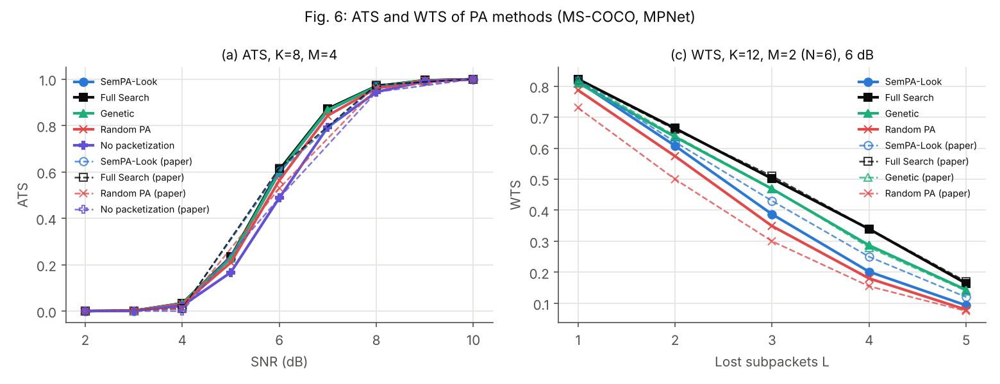
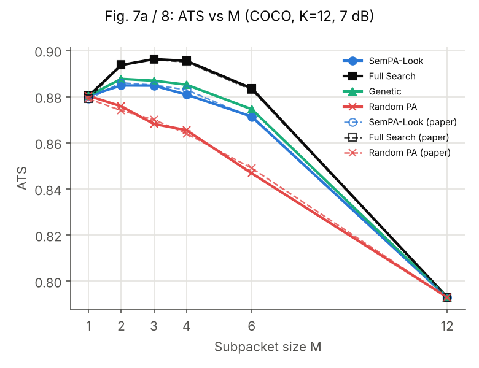
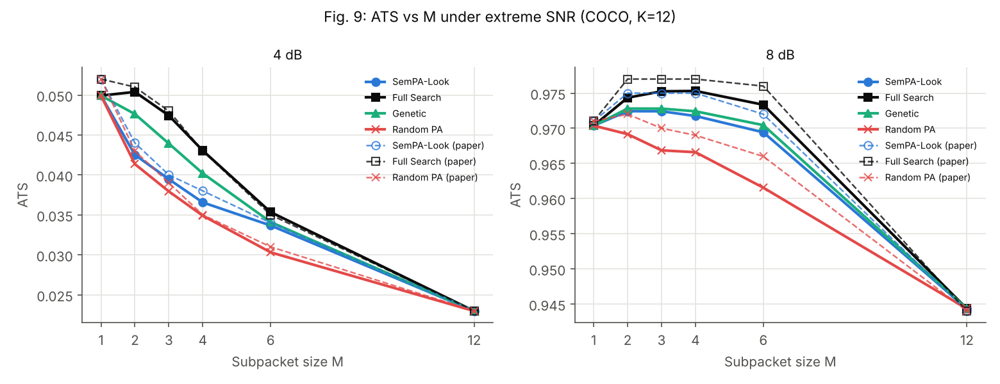
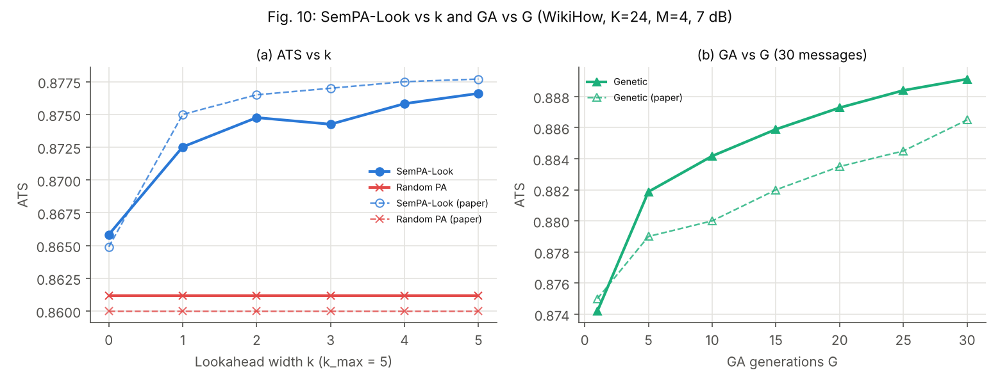
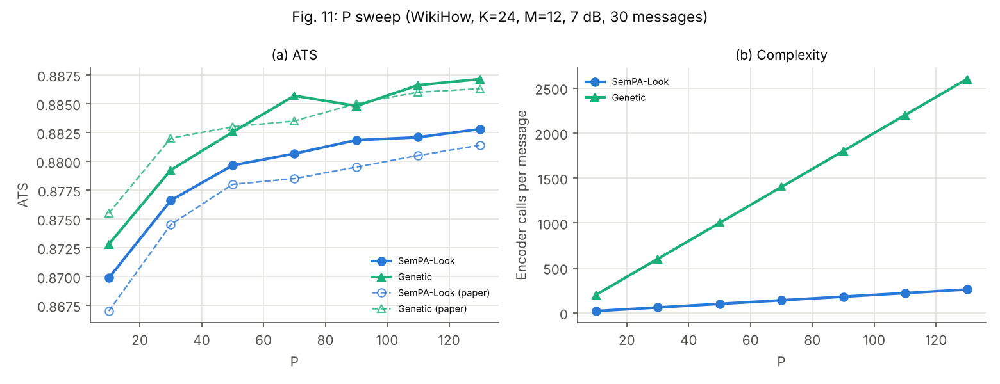
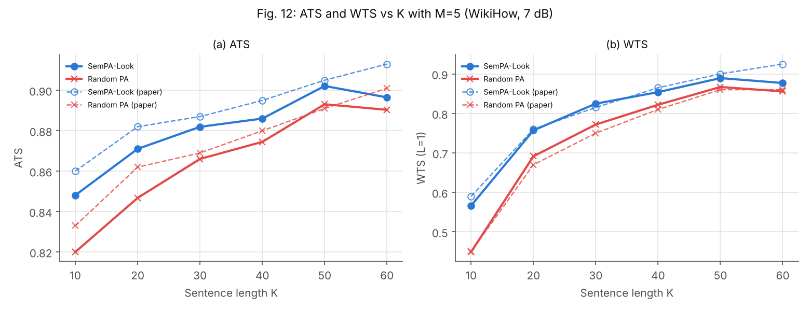
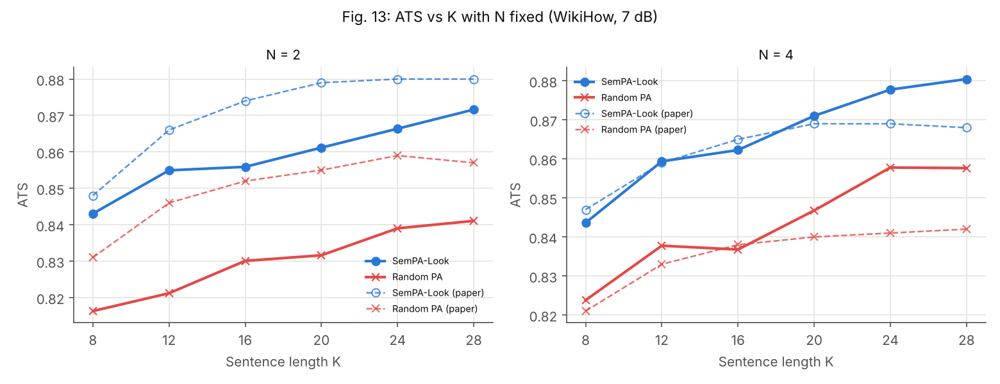

Subword tokenization:

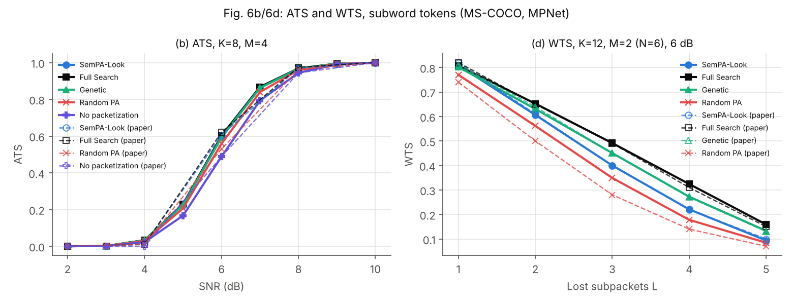
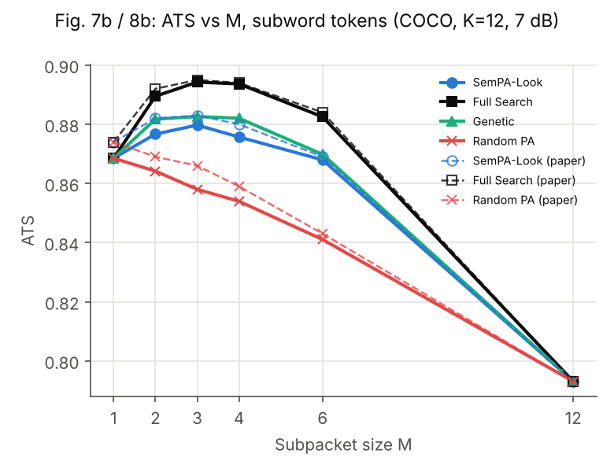
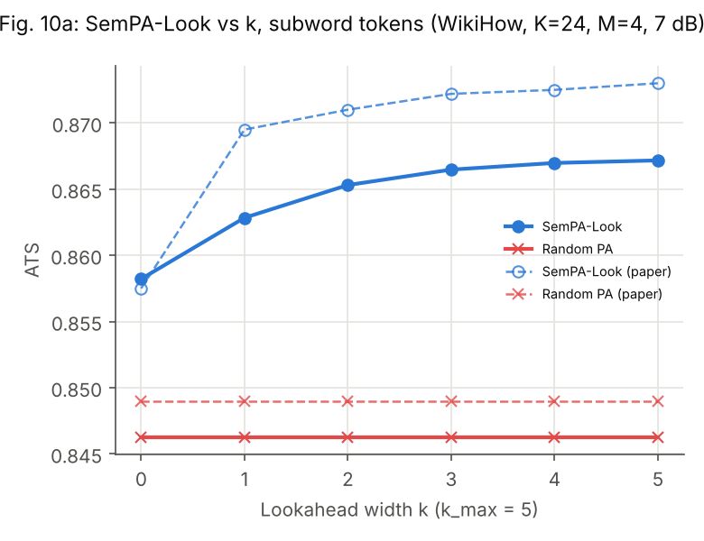
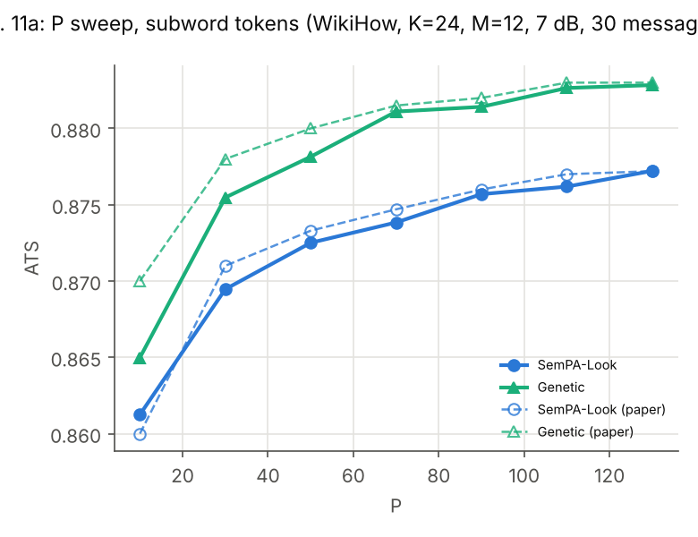
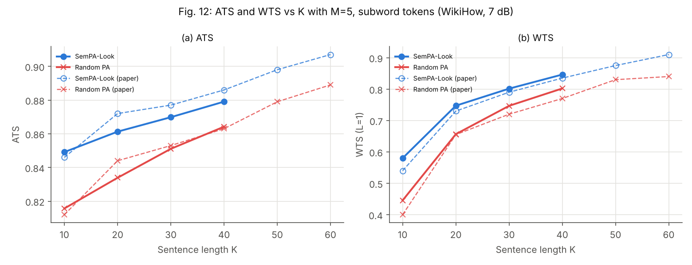
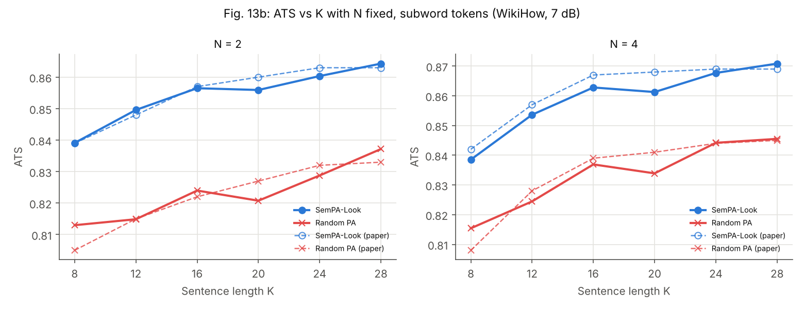

### Rerun

```bash
bash scripts/get_coco_captions.sh       # MS-COCO caption annotations into data/coco/
# WikiHow: put wikihowAll.csv into data/wikihow/
python -m sempalab.repro --config configs/repro/coco_k12.yaml    # any file in configs/repro/
python scripts/make_figures.py          # results/stage4/figures/
python scripts/compare_paper.py         # docs/reproduction_table.md
```

---

# Reproduction Philosophy

Exact numerical equality with the paper is **not** the primary criterion.

The paper leaves some implementation details unspecified, including aspects of:

* reconstruction convention
* caption subset selection
* random-number generation

Therefore, reproduction should primarily compare:

```text
✓ Curve shape
✓ Relative ordering
✓ Gap direction
✓ Rough gap magnitude
✓ Complexity scaling
```

rather than expecting identical absolute ATS values.

A discrepancy is not automatically a failure.

An unexplained discrepancy is.

---

# ATS Saturation

One important characteristic of the evaluation is that cosine-based semantic similarity can compress the difference between packetization strategies.

As a result:

```text
Different packetizations
        ↓
Similar ATS values
```

does not necessarily mean that the algorithms behave similarly.

This is why WTS and computational cost are included in the evaluation framework.

The final reproduction should therefore report:

```text
ATS
WTS
Runtime
Logical Calls
Encoder Calls
Cache Hits
```

---

# Configuration

The long-term experiment interface uses YAML configuration.

Example:

```yaml
experiment: repro_fig6

dataset: ms_coco
tokenization: word

K: 12
M: 4
B: 100

P: 10
k: 4

snr_db:
  - 2
  - 4
  - 6
  - 8
  - 10

packet_bits: 300

encoder: all-mpnet-base-v2

mode: paper_faithful

seed: 42
```

Paper-reproduction experiments are launched through:

```bash
python -m sempalab.repro --config configs/repro/coco_k8.yaml
```

This allows the same experiment to be reproduced without modifying source code.

---

# Results

All experiment outputs should be stored under:

```text
results/
```

Example:

```text
results/
├── stage2/
│   ├── acceptance.csv
│   ├── acceptance.json
│   └── summary.json
│
├── reproduction/
│   ├── fig3.csv
│   ├── fig6.csv
│   ├── fig8.csv
│   └── fig9.csv
│
└── figures/
    ├── fig3.png
    ├── fig6.png
    └── ...
```

The principle is:

```text
Experiment
    ↓
CSV / JSON
    ↓
Analysis script
    ↓
Figure / Table
```

not:

```text
Experiment
    ↓
Screenshot
```

---

# Research Extension 1 — Channel-Aware Aggregation

The paper assumes independent packet erasures. Under bursty (Gilbert–Elliott) and correlated Rayleigh fading erasures, at the same average packet error rate p = 0.05–0.6, SemPA-Look's advantage over Random PA largely disappears. At N = 6 and Gilbert–Elliott ρ = 0.6 it keeps 8% of the attainable gain, against 36% under i.i.d. losses. **CASA** (channel-aware semantic aggregation) fits a p- and channel-aware pairwise surrogate of φ. Under the channel's slot survival probabilities it reduces aggregation to a quadratic assignment problem, which CASA searches with swaps before checking the best candidates exactly. It also optimises which packet each group rides in.

| COCO K = 12, MPNet, 100 messages | Share of the oracle's gain over Random PA (p = 0.2–0.6) |
|---|---|
| SemPA-Look | 1–47% (falls with channel memory) |
| Full Search assuming i.i.d. losses | 32–100% |
| Swap local search + channel-aware slot order | 59–76% |
| **CASA** | **85–92% on every channel** |

CASA beats SemPA-Look by up to +0.040 ATS (+8.1%) with every 95% CI above zero. The gains hold, smaller, when the partitions are re-scored under MiniLM and BGE-small, and on WikiHow K = 24. A deep packet interleaver is the main competitor: SemPA-Look needs a 1.5–2.3× deeper interleaver to match CASA. Details, limits and rerun commands: [docs/channel_aware.md](docs/channel_aware.md). Full tables: [docs/channel_aware_tables.md](docs/channel_aware_tables.md).

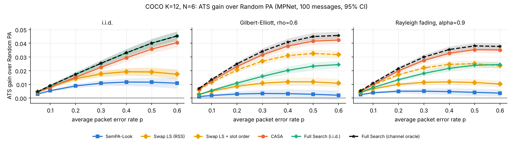

---

# Research Extensions

Only after reproduction and analysis will SEMPA-LAB introduce an original research contribution.

Potential directions include:

### Adaptive Surrogate Weighting

Adapt the relative importance of surrogate terms according to packet-loss probability.

### Adaptive Lookahead

Choose `k` dynamically based on the current search state or marginal gain.

### Risk-Aware Packetization

Optimize not only expected semantic quality but also the risk of severe semantic degradation.

### Bursty Channels

Replace independent packet erasures with a correlated channel model such as a Gilbert–Elliott process.

### Saliency-Aware Sampling

Bias candidate generation toward semantically important tokens.

### Learned Surrogate

Train a lightweight model to approximate expensive semantic evaluations.

The final extension will be selected based on weaknesses discovered during the reproduction and analysis stages.

---

# Research Workflow

The intended research loop is:

```text
                ┌──────────────────┐
                │     PAPER        │
                └────────┬─────────┘
                         │
                         ▼
                ┌──────────────────┐
                │    REPRODUCE     │
                └────────┬─────────┘
                         │
                         ▼
                ┌──────────────────┐
                │     ANALYZE      │
                │  Where does it   │
                │     break?       │
                └────────┬─────────┘
                         │
                         ▼
                ┌──────────────────┐
                │     EXTEND       │
                │  Research mode   │
                └────────┬─────────┘
                         │
                         ▼
                ┌──────────────────┐
                │     ABLATION     │
                └────────┬─────────┘
                         │
                         ▼
                ┌──────────────────┐
                │    EVIDENCE      │
                └──────────────────┘
```

This prevents the common research failure mode of modifying a baseline before establishing that the baseline itself is correct.

---

# Project Status

### Current milestone

**Core algorithmic implementation**

Completed:

* [x] Project architecture
* [x] Core data structures
* [x] Partition enumeration
* [x] Packet reconstruction
* [x] Semantic encoder wrapper
* [x] Encoder batching
* [x] Encoder caching
* [x] Semantic similarity
* [x] ATS
* [x] WTS
* [x] Channel model foundation
* [x] Full Search
* [x] Random PA
* [x] No Packetization
* [x] Greedy TSS
* [x] Greedy RSS
* [x] SemPA-Look
* [x] Genetic Algorithm
* [x] Algorithm-level tests

Current next milestone:

* [x] 100-message Stage 2 acceptance experiment

Then:

* [x] Physical communication system
* [x] MS-COCO / WikiHow reproduction (Stage 4)
* [x] Paper reproduction report ([docs/reproduction.md](docs/reproduction.md))
* [x] Limitation analysis ([docs/limitations.md](docs/limitations.md))
* [x] Research extension 1: channel-aware aggregation ([docs/channel_aware.md](docs/channel_aware.md))
* [ ] Final ablation and evaluation

---

# Citation

If you use this repository or build upon the implementation, please cite the original work:

```bibtex
@article{lee2026sempalook,
  author  = {Lee, Seunghun and Park, Jihong and Choi, Jinho and Park, Hyuncheol},
  title   = {Low-Complexity Semantic Packet Aggregation for Token Communication via Lookahead Search},
  journal = {IEEE Transactions on Communications},
  year    = {2026}
}
```

---

# Acknowledgements

This project is an independent research implementation based on the SemPA-Look framework.

The original work introduces semantic packet aggregation with residual semantic scoring and lookahead search to achieve near-optimal semantic performance while substantially reducing computational complexity.

---

# License

This repository is intended for research and educational purposes.

The original paper, datasets, pretrained models, and third-party dependencies remain subject to their respective licenses.

---

<p align="center">

### SEMPA-LAB

**Reproduce → Analyze → Extend**

*Semantic communication research through reproducible engineering.*

</p>
