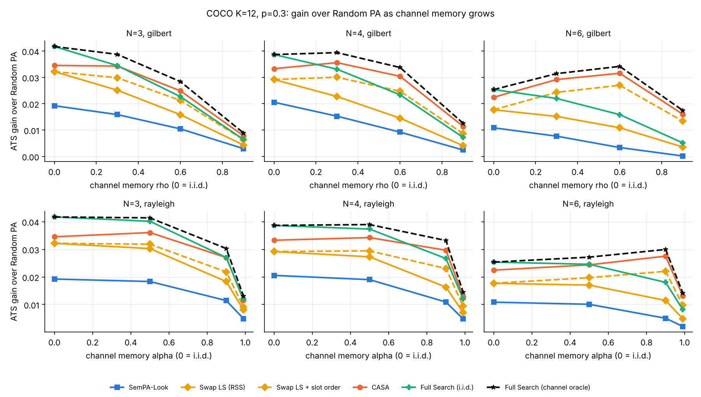
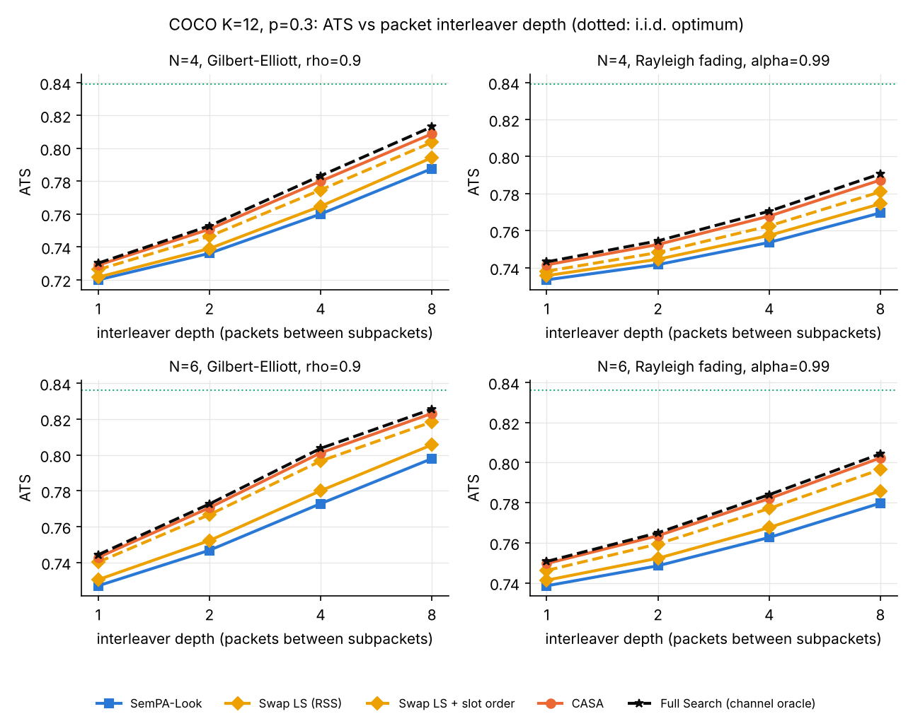
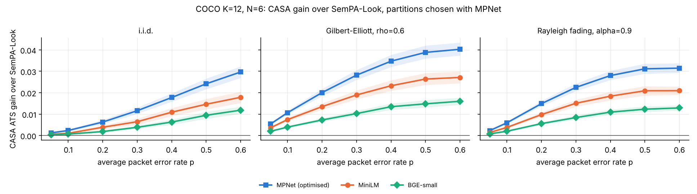
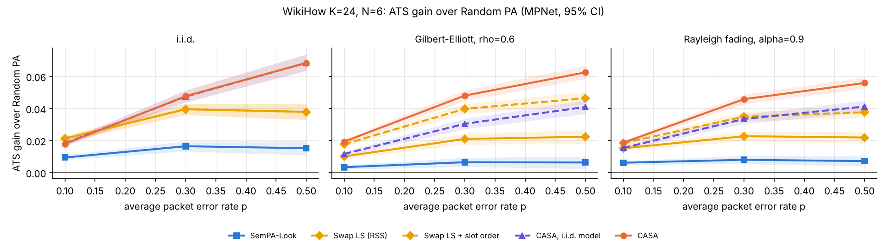

# Channel-aware aggregation under bursty and fading erasures

This is the first research extension, direction 2 of [limitations.md](limitations.md), combined with the p-aware pairwise surrogate from direction 3. The paper assumes every packet is erased independently with the same probability p. We drop that assumption and model bursts and fading. Then we ask how the paper's method behaves and what an aggregator that knows the channel can recover.

**Short answer.** Correlated losses break SemPA-Look's advantage. With six subpackets per message (N = 6) on a Gilbert–Elliott channel with lag-1 correlation ρ = 0.6, SemPA-Look keeps only 8% of the possible gain over Random PA. Under i.i.d. losses it keeps 36%. Under memory, *which packet each group rides in* matters, not only how tokens are grouped. Our channel-aware method, **CASA**, exploits that. It captures **85–92% of the oracle's gain over Random PA on every channel we tested**. It beats SemPA-Look by up to **+0.040 ATS (+8.1%)**, and it beats even the exhaustively searched i.i.d.-optimal partition by up to +0.018 ATS. All of these differences have 95% CIs that exclude zero. The gains hold, smaller, when the same partitions are re-scored under MiniLM and BGE-small. They also hold on 24-token WikiHow sentences, where Full Search is infeasible. Two honest limits apply. A packet interleaver, if the delay budget allows one, removes much of the burst problem for every method. CASA's quality equals SemPA-Look's with a 1.5–2.3× deeper interleaver. At low loss (p ≈ 0.1), CASA only ties a strong swap-search baseline.

All numbers: MPNet (`all-mpnet-base-v2`) defines the objective and the headline numbers, 100 messages per point, exact ATS under each channel's joint loss law, paired per-message differences with bootstrap 95% CIs (5,000 resamples). Full tables: [channel_aware_tables.md](channel_aware_tables.md).

## 1. Model

**Channels**, all compared at the same average packet error rate p ∈ {0.05, 0.1, 0.2, 0.3, 0.4, 0.5, 0.6}:

| Channel | Memory parameter | Notes |
|---|---|---|
| i.i.d. erasures | none | the paper's model |
| Gilbert–Elliott (two-state Markov, Bad state = erased) | lag-1 state correlation ρ ∈ {0.3, 0.6, 0.9} | mean burst 1/((1−p)(1−ρ)) packets; general loss_good/loss_bad supported |
| Correlated Rayleigh fading + the paper's uncoded BPSK 300-bit packet | AR(1) fade coefficient α ∈ {0.5, 0.9, 0.99} | mean SNR solved so that E[PER] = p; the joint law is integrated over the fades by Monte Carlo (400k draws) |

**Layout.** Slot n of message b goes to packet b + n·D of a continuous stream (a diagonal interleaver, `aggregation.aggregate_diagonal`). D = 1 is the paper's cyclic layout without its wrap-around. Every message then sees the same joint law Q over its N slots, and ATS is exact:

ATS_Q(G) = Σ_s Q(s) · φ(union of the groups in surviving slots).

Under i.i.d. losses Q is exchangeable, so only the partition matters. Under memory, adjacent slots tend to fail together, so the **slot order** matters too. Example: put two groups that carry overlapping meaning in slots that rarely fail together. A system test checks the stream, layout and deaggregation against Q (`tests/test_correlated_channel.py`).

## 2. Method

**CASA (channel-aware semantic aggregation)**, in `src/sempalab/channel_aware.py`:

1. **p- and channel-aware pairwise surrogate.** We approximate φ by φ(x) ≈ a₀ + Σ aᵢxᵢ + Σ bᵢⱼxᵢxⱼ over token-survival indicators x. The fit is least squares on random token subsets whose survivor count follows the channel's law, restricted to partial survival (1 to N−1 slots). Losing all or no slots adds the same constant for every partition, and on a bursty channel most of the probability sits there. The default budget is 4× the number of parameters (316 subsets at K = 12, 1,204 at K = 24).
2. **Closed form under the channel.** Taking expectations, ATS_Q ≈ a₀ + Σ aᵢ r[g(i)] + Σ bᵢⱼ R[g(i), g(j)]. Here r and R are the slot survival and pairwise joint-survival probabilities of Q. The channel enters only through (r, R). The search becomes a quadratic assignment problem with no encoder in the loop.
3. **Search.** Best-improvement token swaps over labelled assignments, from 20 random restarts.
4. **Exact re-rank.** The 5 best distinct local optima are scored by exact ATS_Q under their best slot order (2^N calls each).

**Slot ordering alone** ("+ order") is a cheap channel-aware fix for any channel-blind partition. It needs the 2^N similarities of the partition and then tries all N! orders for free.

**Baselines.** All are required by the plan:
- Random PA.
- Deterministic modular interleaving (token i → slot i mod N).
- SemPA-Look (P = 10, k = 4).
- Swap local search on the paper's RSS surrogate, Σₙ φ(W∖Gₙ). It is new here, best improvement from one random start.
- Their "+ order" variants.
- CASA fitted as if the channel were i.i.d. (`casa_iid`, the p-aware but memory-blind ablation).
- Full Search under i.i.d. losses, the best channel-blind partition.
- The channel oracle: Full Search over ordered partitions, exhaustive at K = 12.

Hyperparameters (budget, partial-survival fitting, number of re-ranked candidates) were chosen on 12 WikiHow K = 12 messages, not on the COCO evaluation set.

## 3. Results on MS-COCO, K = 12

### Most of the attainable gain, on every channel

Share of the oracle's gain over Random PA, (ATS − Random) / (Oracle − Random), averaged over p = 0.2–0.6:

| Channel | SemPA-Look N=3 | Swap LS + order N=3 | Full Search i.i.d. N=3 | **CASA N=3** | SemPA-Look N=6 | Swap LS + order N=6 | Full Search i.i.d. N=6 | **CASA N=6** |
|---|---:|---:|---:|---:|---:|---:|---:|---:|
| i.i.d. | 41% | 70% | 100% | **85%** | 36% | 59% | 100% | **89%** |
| Gilbert–Elliott ρ = 0.3 | 38% | 73% | 90% | **88%** | 20% | 70% | 72% | **92%** |
| Gilbert–Elliott ρ = 0.6 | 36% | 73% | 81% | **88%** | 8% | 76% | 49% | **92%** |
| Gilbert–Elliott ρ = 0.9 | 33% | 71% | 73% | **87%** | 1% | 76% | 32% | **92%** |
| Rayleigh α = 0.5 | 41% | 72% | 97% | **87%** | 31% | 64% | 90% | **90%** |
| Rayleigh α = 0.9 | 37% | 70% | 90% | **88%** | 15% | 70% | 62% | **92%** |
| Rayleigh α = 0.99 | 37% | 68% | 93% | **88%** | 16% | 65% | 64% | **92%** |

N = 4 sits between these two columns; see the full tables. Two readings follow.
- Under memory, even the *exhaustive* channel-blind optimum falls to 32–73% at N = 6. This is the size of the error the i.i.d. assumption causes, independent of any search heuristic.
- CASA's share hardly moves with memory. Its N = 6 share is higher under bursts than under i.i.d. losses, because slot ordering is extra leverage that only CASA and the oracle use.

### Example point: N = 6, Gilbert–Elliott ρ = 0.6, p = 0.5

| Algorithm | ATS | Calls / message |
|---|---:|---:|
| Random PA | 0.5971 | 0 |
| SemPA-Look | 0.5998 | 190 |
| Swap LS (RSS) | 0.6089 | 66 |
| SemPA-Look + slot order | 0.6258 | 253 |
| Swap LS + slot order | 0.6297 | 129 |
| Full Search, i.i.d. optimum | 0.6204 | 665,280 |
| **CASA** | **0.6387** | 439 |
| Full Search, channel oracle | 0.6420 | 665,280 |

CASA − SemPA-Look = +0.0388 [+0.0359, +0.0420]. CASA − Full Search (i.i.d.) = +0.0182 [+0.0163, +0.0204]. CASA − Swap LS + order = +0.0090 [+0.0076, +0.0103].




### What the gain is made of

- **Slot order is the cheap half.** Reordering SemPA-Look's own partition lifts its ATS from 0.5998 to 0.6258 in the example above, for 63 extra calls. Every "+ order" variant gains under memory and, by construction, nothing under i.i.d. losses.
- **Channel-aware grouping is the rest.** CASA beats the strongest blind baseline with ordering, Swap LS + order, by +0.001 to +0.023 ATS at p ≥ 0.3 on every channel and N (all CIs exclude zero). At p ≤ 0.1 the difference is between −0.001 and +0.002.
- **Memory-blind p-awareness is not enough.** `casa_iid` is as good as CASA under i.i.d. losses but falls behind once losses are correlated (e.g. 0.6177 vs 0.6387 above).
- **Swap search on the paper's own surrogate beats SemPA-Look** at every point, typically by about 2× in captured headroom. This is a baseline the paper did not include (limitation L9).

### Compute

At K = 12, CASA uses 280–440 encoder calls per message, against 50–190 for SemPA-Look and 130–230 for Swap LS + order. In the compute-matched run, CASA's fitting budget is halved (158 subsets) and Swap LS gets 3 restarts. At N = 3 and N = 4, CASA then uses fewer calls than Swap LS + order. It still wins at p ≥ 0.3 on both bursty channels, by +0.002 to +0.006 (for example +0.006 at N = 4, Rayleigh α = 0.9, p = 0.5), and ties under i.i.d. losses at p = 0.3 (−0.0005 at N = 3). At N = 6, Swap LS already queries all 66 pairs, so extra restarts cost it nothing and change little. Tables: [compute-matched ablation](channel_aware_tables.md#compute-matched-ablation-swap-ls-with-3-restarts-casa-with-158-fitting-subsets).

### Interleaving depth: the honest competitor

A packet interleaver spaces a message's subpackets D packets apart at a delay cost of (N−1)·D packets. Under strong memory (Gilbert ρ = 0.9, Rayleigh α = 0.99), every method gains steeply with D.

To compare the two levers, we interpolate each method's ATS over log₂ D and ask how much deeper an interleaver SemPA-Look needs to match CASA at depth D:
- **SemPA-Look needs a 1.5–2.3× deeper interleaver** to match CASA: 1.5–1.7× on Gilbert ρ = 0.9 at N = 4, and 1.7–2.3× elsewhere.
- Swap LS + order needs a 1.1–1.4× deeper one.

For example, at N = 6, Gilbert ρ = 0.9, p = 0.3, CASA reaches 0.7705 at D = 2 and SemPA-Look 0.7728 at D = 4. CASA is also the best non-oracle method at every depth for p ≥ 0.1 on both bursty channels. So channel-aware aggregation buys roughly the delay of one doubling of interleaver depth against the paper's method. It combines with interleaving rather than replacing it. Against a well-searched blind partition with slot ordering, the delay it saves is small.



## 4. Re-scored under other encoders

The partitions chosen with MPNet are re-scored under `all-MiniLM-L6-v2` and `BAAI/bge-small-en-v1.5` (`--rescore`). The channel and partitions stay the same; only φ changes.
- CASA's gain over SemPA-Look stays positive with CIs above zero at every bursty point and every N. For N = 6, Gilbert ρ = 0.6, p = 0.5 it is +0.0264 [+0.0237, +0.0292] under MiniLM and +0.0148 [+0.0131, +0.0166] under BGE-small, against +0.0388 under MPNet.
- Its gain over Swap LS + order also stays positive at p ≥ 0.3, at about half the MPNet size.

BGE-small packs cosines closer to 1, so all of its absolute differences are compressed. The ordering of methods does not change. The gains are therefore not an artefact of optimising and scoring with the same encoder. The size of the gain is partly encoder-dependent, which is the circularity concern from limitations.md L5–L6.



## 5. Longer messages: WikiHow, K = 24, N = 6

Full Search is infeasible here, so there is no oracle. CASA fits each message on one shared pool of 1,204 subsets, reweighted to each channel by importance weights. Its reported calls are what a standalone run would need.

| Channel, p | SemPA-Look | SemPA-Look + order | Swap LS + order | **CASA** |
|---|---:|---:|---:|---:|
| i.i.d., 0.3 | 0.8094 | 0.8094 | 0.8325 | **0.8407** |
| i.i.d., 0.5 | 0.6450 | 0.6450 | 0.6677 | **0.6982** |
| Gilbert ρ = 0.6, 0.3 | 0.7745 | 0.7957 | 0.8078 | **0.8161** |
| Gilbert ρ = 0.6, 0.5 | 0.5940 | 0.6206 | 0.6340 | **0.6502** |
| Rayleigh α = 0.9, 0.3 | 0.7802 | 0.7940 | 0.8071 | **0.8180** |
| Rayleigh α = 0.9, 0.5 | 0.5920 | 0.6096 | 0.6225 | **0.6408** |
| calls / message | 190 | 253 | 1,623 | 1,470 |

At p = 0.1, CASA and Swap LS + order are within 0.004 of each other, and CASA is the one behind under i.i.d. losses (0.9528 vs 0.9562). The gap to SemPA-Look grows with K: +0.056 ATS (+9.5%) at Gilbert ρ = 0.6, p = 0.5. At this length SemPA-Look's cheapness is real, though. It uses about 8× fewer calls than either search.



## 6. Limits and open points

- **Interleaving first.** If a deployment can afford a deep packet interleaver, most of the burst penalty goes away for every method. CASA's value is at a fixed delay budget, or under fading too slow for the batch to average out.
- **Known channel law.** CASA uses the true Q (r and R). Estimating it from feedback, and how robust CASA is to a wrong ρ or α, is untested.
- **Low loss.** At p ≈ 0.1, CASA ties a well-searched blind partition with ordering. The extra encoder calls are not worth it there.
- **Same receiver.** The receiver still just drops lost tokens (L1). Recovery-aware aggregation (direction 1) can slot into this framework as another law over survival patterns.
- **Metric.** Everything is embedding cosine. Re-scoring with three encoders reduces the circularity concern but is not a human judgment.

## 7. Rerun

```bash
python -m sempalab.channel_experiment --config configs/channel/coco_k12.yaml          # about 30 min on 4 CPUs
python -m sempalab.channel_experiment --config configs/channel/coco_k12.yaml --rescore minilm
python -m sempalab.channel_experiment --config configs/channel/coco_k12.yaml --rescore bge-small
python -m sempalab.channel_experiment --config configs/channel/coco_k12_stride.yaml   # about 27 min
python -m sempalab.channel_experiment --config configs/channel/coco_k12_matched.yaml  # about 21 min
python -m sempalab.channel_experiment --config configs/channel/wikihow_k24.yaml       # about 90 min
python scripts/make_channel_figures.py   # results/channel/figures/, docs/channel_aware_tables.md
```

Evaluation sets are the frozen ones in `results/stage4/eval_sets/`, so no COCO or WikiHow download is needed.
