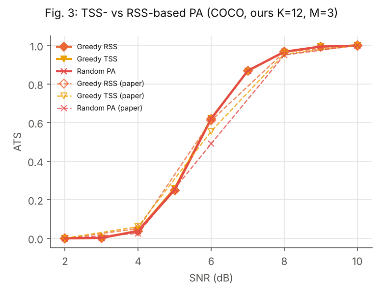

# Stage 4 reproduction report

What we reproduced from Lee, Park, Choi, Park, *Low-Complexity Semantic Packet
Aggregation for Token Communication via Lookahead Search*, IEEE TCOM vol. 74,
pp. 9639–9654, 2026, and where our numbers differ from the paper's.

- Encoder: `all-mpnet-base-v2` (the paper's), for every number below.
- Channel: BPSK over AWGN, 300-bit packets, p = 1 − (1 − Q(√(2γ)))^300.
- Metrics: exact ATS over all 2^N erasure patterns, and the paper's WTS
  (worst case over losing exactly L subpackets).
- Every interpretation we had to make is listed in [assumptions.md](assumptions.md).
- Every number we compare is in [reproduction_table.md](reproduction_table.md),
  generated by `scripts/compare_paper.py` from `results/stage4/*/summary.csv`
  and `results/stage4/paper_reference.yaml`. "Text/table" values are printed
  in the paper. "Read off plot" values were read from the PDF figures by eye
  (about ±0.003 on ATS axes, ±0.02 on WTS axes).

## How to rerun

```bash
bash scripts/get_coco_captions.sh                    # MS-COCO 2017 caption annotations
# WikiHow: wikihowAll.csv into data/wikihow/ (HF dataset Lajvi/wikihowAll)
python -m sempalab.repro --config configs/repro/coco_k12.yaml   # one run per config
python scripts/make_figures.py
python scripts/compare_paper.py
```

The 100-message evaluation sets are frozen in `results/stage4/eval_sets/`, so
the reruns use the same sentences. Runtimes on 4 CPU cores: about 1 minute
(`coco_k8`) to 70 minutes (`wikihow_len_long`).

## Summary

| Result | Paper | Ours | Verdict |
|---|---|---|---|
| ATS vs M, K=12, 7 dB (Fig. 7a, SemPA-Look, M = 1..12) | 0.879 / 0.886 / 0.885 / 0.883 / 0.871 / 0.793 | 0.880 / 0.885 / 0.885 / 0.881 / 0.871 / 0.793 | reproduced (≤ 0.2 %) |
| ATS vs M at 4 and 8 dB (Fig. 9): small M best at 4 dB, M = 2–4 best at 8 dB | yes | yes | reproduced (within 0.005 ATS) |
| SemPA-Look vs Full Search, K=8, M=4, 6 dB (Fig. 6a) | −1.79 % | −2.03 % | reproduced |
| SemPA-Look vs no packetization, 6 dB (Fig. 6a) | +24.0 % | +22.2 % | reproduced |
| SemPA-Look vs k, K=24, M=4, 7 dB (Fig. 10a / 16), k=0 → k=5 | 0.8649 → 0.8777 | 0.8658 → 0.8766 | reproduced |
| GA vs G (Fig. 10b), G=1 → G=30 | 0.875 → 0.8865 | 0.874 → 0.889 | reproduced |
| P sweep, P=130 (Fig. 11a), SemPA-Look / GA | 0.8814 / 0.8863 | 0.8828 / 0.8871 | reproduced |
| SemPA-Look ATS, K=24, M=6, 6/7/8 dB (Table V, no correction) | 0.6206 / 0.8716 / 0.9696 | 0.6316 / 0.8778 / 0.9705 | reproduced |
| GA encoder calls (Table III, Fig. 10b, 11b) | 3,200 / 640 / 2,600 | 3,200 / 640 / 2,600 | exact |
| SemPA-Look encoder calls, P=130, N=2 (Fig. 11b) | 260 | 260 | exact |
| SemPA-Look encoder calls, K=24, M=4 (Table III) | 250 (closed form) | 190 (measured) | see gap 3 |
| ATS and WTS vs K, M=5 (Fig. 12) | rising with K, SemPA-Look above Random PA | same shape, about 1 % lower | shape reproduced |
| ATS vs K with N fixed (Fig. 13): SemPA-Look above Random PA at every K | yes, gap 0.017–0.029 | yes, gap 0.020–0.034 | reproduced |
| Fig. 13: N=2 beats N=4 and ATS saturates by K≈20 | yes | N=4 ≥ N=2 for K ≥ 20, still rising at K=28 | **not reproduced**, gap 4 |
| SemPA-Look vs Random PA, 6 dB (Fig. 6a, Table II) | +14.3 %, +18.5 % | +5.8 %, +2.4 % | **not reproduced**, gap 1 |
| WTS gain over Random PA (Fig. 6c) | +46.2 % | +10.9 % at L=3 | **not reproduced**, gap 1 |
| TSS vs RSS separation (Fig. 3) | RSS > TSS > Random | all three overlap | **not reproduced**, gap 2 |

## Figures

Solid lines are ours, dashed lines with hollow markers are the paper's.




## Gaps we could not close

### 1. Random PA is stronger at 6 dB than in the paper

Our Random PA matches the paper at 7 dB (Fig. 10a: 0.861 vs 0.860; Fig. 8:
within 0.3 % at every M) and at 4 and 8 dB (Fig. 9). At 6 dB it is clearly
stronger: Table II reports 0.5417 for Random PA at K=24, M=4, and we get
0.619, while SemPA-Look matches (0.642 vs 0.634). The same shows up as a
smaller SemPA-Look gain over Random PA in Fig. 6a (+5.8 % vs +14.3 %) and in
the WTS panel Fig. 6c, where our Random PA sits above the paper's curve at
every L.

The paper's 6 dB Random PA values are close to no packetization (1 − p =
0.488), which our exact-ATS Random PA cannot reach: any partition with N > 1
adds partial-reception terms on top of 1 − p. We checked our Random PA
against the paper's definition (one uniformly random valid partition per
message) and could not find a reading of the paper that gives its 6 dB
numbers while keeping the 7 dB ones. We report the gap as unexplained.

Because Full Search, GA and SemPA-Look match the paper at 6 dB, this gap is
in the baseline, not in the proposed method.

### 2. Fig. 3 (TSS vs RSS) setting

The paper does not state K and M for Fig. 3. At N=2 the two greedy rules
pick the same partition, so we used K=12, M=3 (A7 in assumptions.md). In
that setting greedy TSS, greedy RSS and Random PA overlap within 0.005 ATS,
so we do not reproduce the separation the paper shows. The paper's Random PA
in Fig. 3 is again close to 1 − p at 6 dB (0.49), the same pattern as gap 1.

### 3. SemPA-Look encoder calls in Table III

Table III gives SemPA-Look's complexity as (N − 1)·P·(k + 1) = 250 for
N=6, P=10, k=4. With the paper's disjoint lookaheads (eq. 21), the number of
lookaheads at step n is capped by the subpackets still unassigned, so later
steps use fewer than k lookaheads. Counting the encoder calls Algorithm 1
actually makes gives 190. The paper's own Fig. 11b (260 calls at P=130, N=2,
i.e. k collapses to 1) agrees with the measured count, so we report 250 as
the paper's closed form and 190 as measured.

### 4. Fig. 13 (N fixed, K growing) at large K

With N fixed, the paper's ATS flattens from K≈20 and N=2 stays above N=4. Our
curves keep rising up to K=28, and for K ≥ 20 N=4 is slightly above N=2
(SemPA-Look 0.8805 vs 0.8716 at K=28). SemPA-Look's lead over Random PA, the
point of the figure, is reproduced for both N. Long WikiHow sentences with
exactly K words are scarcer, so our K=24 and K=28 sets may come from a narrower
slice of the 20,000 articles we read (A4 in assumptions.md); a different
sentence pool is the most likely cause, but we have not verified it.

## Not reproduced

Subword tokenization, SemPA-GBeam, MCTS, the DeepSC / UTF-8 / Huffman
baselines of Table IV, the Fig. 4 sampling ablations, AIGC / LPIPS (Figs. 14,
15), BLEURT / BERTScore, LLM post-correction and channel coding (Fig. 18).
See [assumptions.md](assumptions.md#not-reproduced).
